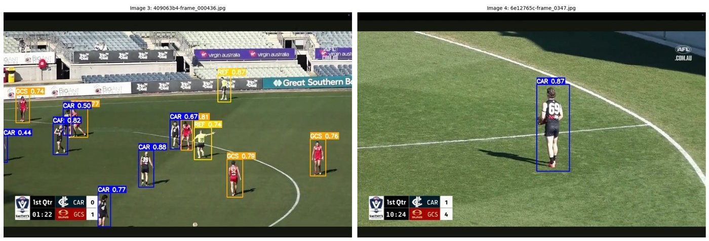
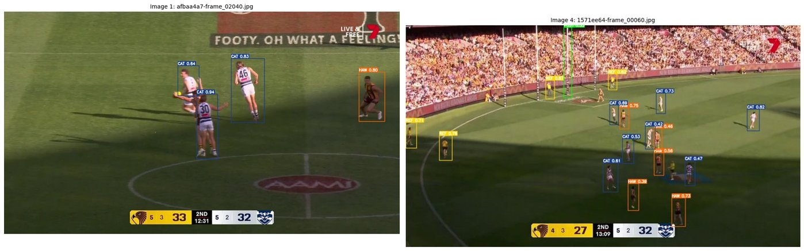

# AFL Player Detection & Tracking (YOLOv11 + DeepSORT)

Detect and track AFL players, referees, the ball and goalposts in broadcast footage, and export a per-frame tracking file for downstream analysis.

Built as part of the **Player Tracking** team in Deakin University's **Redback Operations** capstone (Capstone B, SIT782), within **Project Orion**, a real-time AFL player tracking and crowd monitoring system. The team repository is [Redback-Operations/redback-orion](https://github.com/Redback-Operations/redback-orion).



## My contribution

I owned the **detection and tracking pipeline and its evaluation**:

- Annotated and prepared training frames, and built a reproducible train/validation split.
- Trained and evaluated a YOLOv11-nano detector, then extended it to a unified 7-class model by combining a second match dataset.
- Integrated DeepSORT to give each detection a persistent ID and exported a structured `tracking.csv`.
- Found and fixed a data-leakage problem in an earlier sprint (see [Lessons learned](#lessons-learned)).

Other team members worked on re-identification, cloud deployment, annotation tooling and the dashboard/backend. Those parts are **not** in this repository.

## Pipeline

```
Annotated match frames ──► 80/20 split (seed 42) ──► YOLOv11n training (3 classes)
                                                         │
Second match dataset ──► class remapping ──► combine ──► fine-tune (unified 7 classes)
                                                         │
Match video ──► per-frame detection ──► DeepSORT (persistent IDs) ──► tracking.csv + annotated video
```

| Setting | Value |
|---|---|
| Detector | YOLOv11-nano (`yolo11n.pt`, Ultralytics) |
| Image size / batch | 640 / 16 |
| Baseline training | 50 epochs, 160 train / 40 val frames |
| Unified training | fine-tuned from baseline, early stopping (patience 10, best epoch 19), seed 42, 300 train / 76 val frames |
| Tracker | DeepSORT (`deep-sort-realtime`), `max_age=30` |
| Detection threshold | confidence > 0.4 |

**Unified class list:** `0 CAR` (Carlton), `1 GCS` (Gold Coast Suns), `2 HAW` (Hawthorn), `3 CAT` (Geelong Cats), `4 REF` (referee), `5 BALL`, `6 POST` (goalposts).

## Results

Validation set, honest split (no train/val overlap).

| Model | Classes | Val images | Precision | Recall | mAP@50 | mAP@50-95 |
|---|---|---|---|---|---|---|
| Baseline | CAR, GCS, REF | 40 | 0.930 | 0.880 | **0.949** | 0.510 |
| Unified | 7 classes | 76 | 0.854 | 0.776 | **0.808** | 0.393 |

Per-class results for the unified model:

| Class | Val instances | Precision | Recall | mAP@50 | mAP@50-95 |
|---|---|---|---|---|---|
| CAR | 178 | 0.885 | 0.904 | 0.926 | 0.481 |
| GCS | 172 | 0.935 | 0.924 | 0.959 | 0.509 |
| HAW | 86 | 0.854 | 0.791 | 0.859 | 0.373 |
| CAT | 89 | 0.868 | 0.886 | 0.913 | 0.412 |
| REF | 86 | 0.891 | 0.856 | 0.904 | 0.438 |
| BALL | 6 | 0.975 | 0.333 | 0.361 | 0.172 |
| POST | 23 | 0.566 | 0.739 | 0.734 | 0.369 |

The unified model scores lower overall than the baseline because it solves a harder problem (7 classes, two matches, small objects such as the ball).



## Tracking output

`tracking.csv` has one row per tracked object per frame:

| Column | Meaning |
|---|---|
| `frame` | Frame number |
| `player_id` | Persistent DeepSORT track ID |
| `class` | Class label (e.g. `CAR`, `HAW`, `REF`) |
| `x_center`, `y_center` | Box centre, in **pixels** |
| `width`, `height` | Box size, in pixels |
| `confidence` | Detection confidence |

## Limitations

- **Random frame-level split.** Frames come from the same match videos, so near-identical neighbouring frames can appear in both train and validation. The metrics are indicative, not a measure of performance on an unseen match.
- **Small dataset.** 376 annotated frames in total across two matches.
- **Ball detection is weak** (mAP@50 0.36 on only 6 validation instances) because it is small, fast and often occluded. Goalposts (POST) are also only moderate at 0.73.
- **Pixel coordinates only.** Distances in metres would need field calibration, for example using the goalposts as fixed reference points. This is not implemented here.
- **ID switches.** DeepSORT can swap or restart IDs after occlusions and in crowded packs. No tracking-specific metrics (such as MOTA or IDF1) were computed.

## Lessons learned

- **Data leakage.** An early sprint reported mAP@50 of about 0.98 because the same images were used for training and validation. Adding a proper seeded split gave the honest 0.949 baseline. Always check how the validation set was built before trusting a high score.
- **Class remapping.** When combining datasets from different annotation exports, class indices must be explicitly remapped to one shared schema before training.
- **Secrets hygiene.** API keys do not belong in notebooks. Load them at run time (for example with `getpass`) and rotate any key that has been exposed.

## Repository contents

| File | Description |
|---|---|
| `afl_player_detection_tracking.ipynb` | Training, evaluation and tracking notebook, saved with outputs |
| `requirements.txt` | Python dependencies |
| `images/` | Example outputs used in this README |

## Running it

The notebook was developed on **Google Colab with a T4 GPU** and reads data and weights from Google Drive. To re-run it:

1. Open the notebook in Colab and select a GPU runtime.
2. Replace the Drive paths (search for `Colab Notebooks/Project_Orion`) with your own locations.
3. Run the cells in order.

The training data, match videos and trained weights are **not** included. The footage is broadcast material and the annotations belong to the project.

## Acknowledgements

Redback Operations and Deakin University for the project framework, and the Project Orion team, project lead and mentors for their guidance and collaboration.
